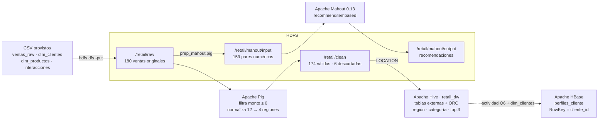

# 27:00 – 29:30 · Cierre

## Tarjeta de transición

```text
Cierre
Flujo demostrado · Qué resuelve cada herramienta · Resultado y limitación
```

## Diagrama del flujo efectivamente demostrado

Mostrar este diagrama en pantalla (en VS Code con vista previa Markdown, o exportado a imagen desde https://mermaid.live).



Versión texto (por si no se renderiza Mermaid):

```text
CSV ──put──► HDFS /retail/raw ──► Pig (ETL) ──► HDFS /retail/clean ──► Hive retail_dw (SQL analítico)
                    │                                                         │
                    │                                                         └─(Q6 + dim_clientes)─► HBase perfiles_cliente (get/put por RowKey)
                    └──► Pig prep ──► /retail/mahout/input ──► Mahout recommenditembased ──► /retail/mahout/output
```

## Narración

### Flujo (≈40 s)

> Este es el flujo que demostré. Los cuatro CSV entraron sin modificar a HDFS, en `/retail/raw`. Pig leyó las 180 ventas, descartó 6 con monto negativo y estandarizó 12 variantes de región a las 4 oficiales, dejando 174 ventas en `/retail/clean`. Hive registró esas carpetas como tablas del data warehouse `retail_dw` y sobre ellas ejecuté las consultas por región, categoría y top de productos; el conteo de 174 coincide con el de Pig. Desde ahí salieron dos ramas: HBase, con perfiles de clientes consultables por RowKey, y Mahout, que generó recomendaciones a partir de las interacciones de compra.

### Qué problema resuelve cada herramienta (≈50 s)

| Herramienta | Problema que resuelve | Tipo de acceso |
|---|---|---|
| **HDFS** | Almacenar archivos grandes de forma distribuida y tolerante a fallos | Archivos completos, escritura una vez |
| **Pig** | Transformar y limpiar datos crudos con un flujo de pasos (ETL) | Procesamiento por lotes |
| **Hive** | Analizar con SQL datos ya limpios: agregaciones y JOIN | Analítico, recorre tablas completas |
| **HBase** | Leer y modificar un registro puntual en milisegundos | Aleatorio por clave (RowKey) |
| **Mahout** | Aprender patrones de los datos: recomendaciones | Aprendizaje automático por lotes |

> HDFS es la base de almacenamiento. Pig es para transformar: es procedimental y conviene cuando hay que limpiar paso a paso. Hive es para preguntar: es declarativo, con SQL, y conviene para análisis agregado. HBase es para acceso operativo por clave, cuando necesito un cliente específico y no un resumen. Y Mahout es para aprender de los datos, en este caso qué productos se compran juntos.

### Resultado de negocio (≈30 s)

> El resultado de negocio principal es que la facturación está muy concentrada: el Notebook solo representa el 57,6 % de las ventas, 34,5 de 59,9 millones, y Tecnología el 61,5 %. Además, Concepción tiene tantas ventas como las otras regiones pero el menor ticket promedio, y dos productos del catálogo, la Cafetera y las Mancuernas, no se vendieron nunca. Mi recomendación sería diversificar: usar las recomendaciones de Mahout para ofrecer productos de mayor valor en Concepción y revisar el surtido de Hogar y Deportes.

### Limitación técnica (≈30 s)

> La principal limitación técnica es la escala: todo corre en un solo nodo, en modo pseudo-distribuido, con replicación 1 y con 180 registros. Así demuestro el flujo, pero no la tolerancia a fallos ni el rendimiento real de Hadoop, y para un volumen tan pequeño el costo de lanzar trabajos MapReduce es mayor que el procesamiento en sí. Además, HBase y Mahout no están integrados automáticamente con Hive: los valores de actividad se cargaron en HBase con comandos manuales a partir de la consulta de Hive. En producción esto se automatizaría, por ejemplo con una tabla Hive asociada a HBase o con una carga masiva.

### Despedida (≈10 s)

> Los scripts, comandos y resultados están entregados en Moodle junto con el README. Muchas gracias.

## Tarjeta final (3 s)

```text
Gracias
[TU NOMBRE] · Sección [XXX] · ES3 Big Data TI2081
```

## Checklist de rúbrica

- [x] Diagrama del flujo efectivamente demostrado.
- [x] Criterio 8 — comparación de herramientas y alcance.
- [x] Resultado de negocio + limitación técnica.
- [x] Criterio 10 — duración ≤ 30:00.
